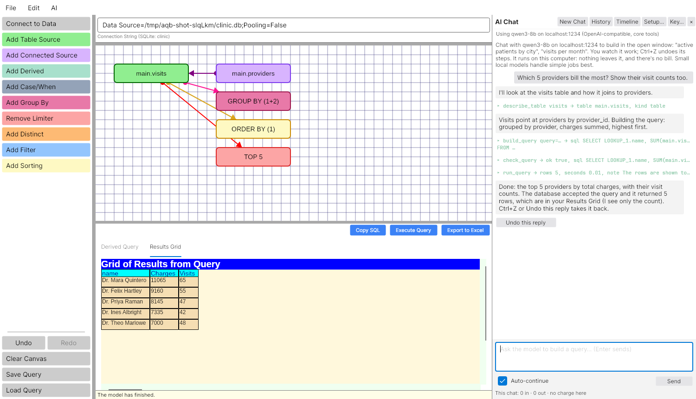
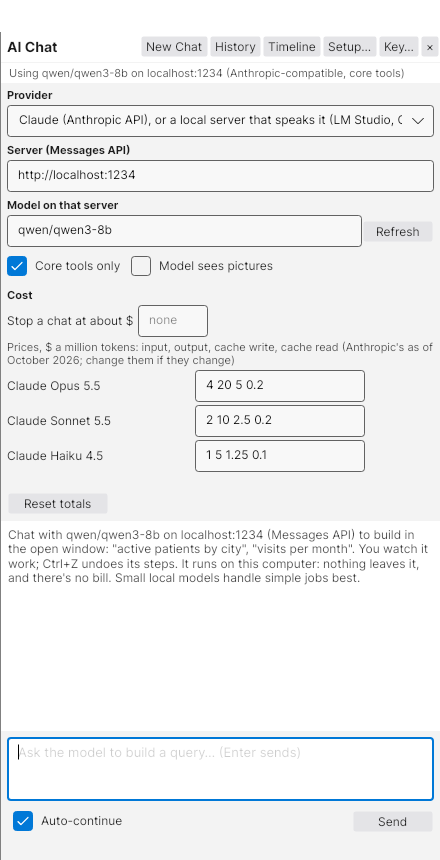
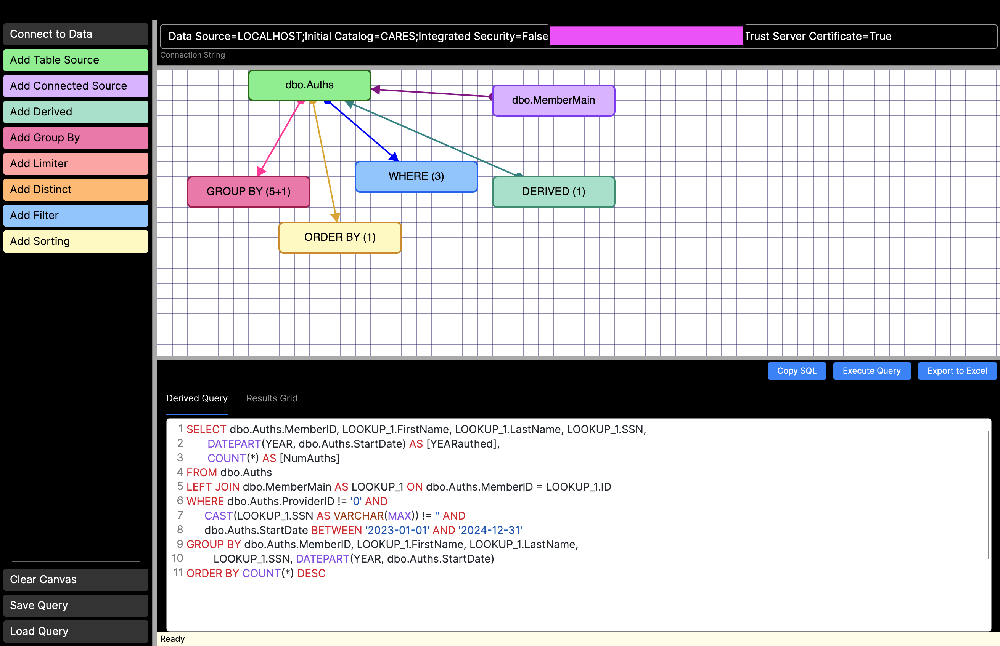
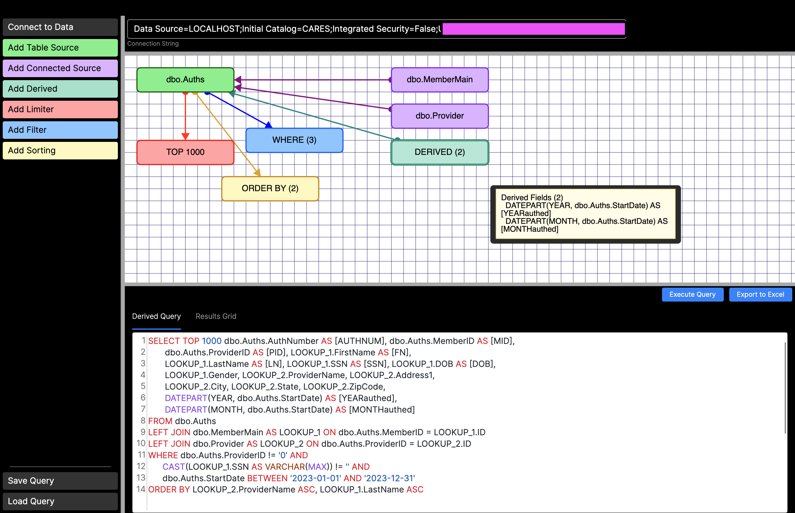
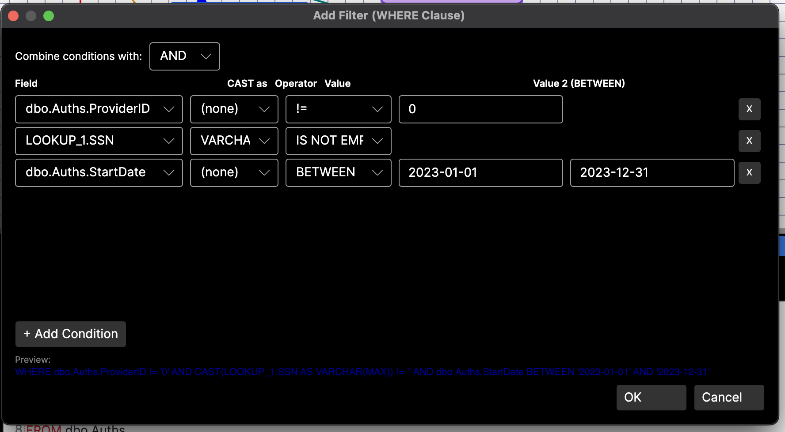
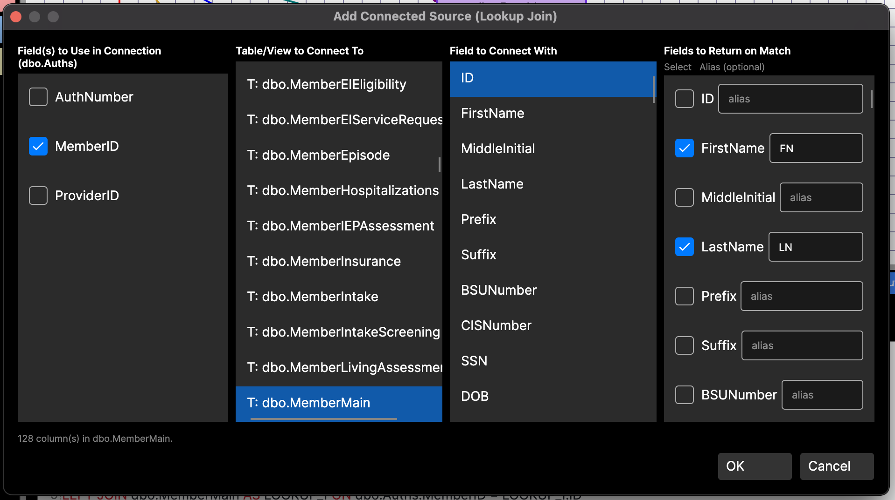
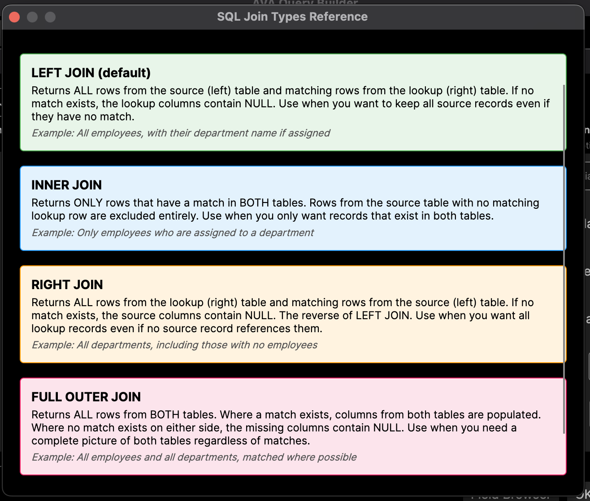
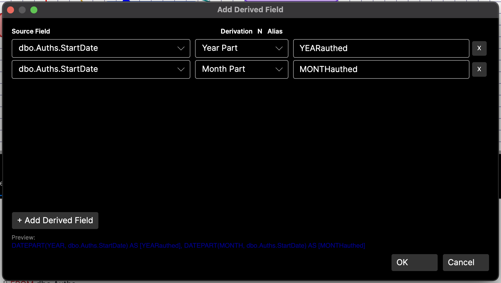
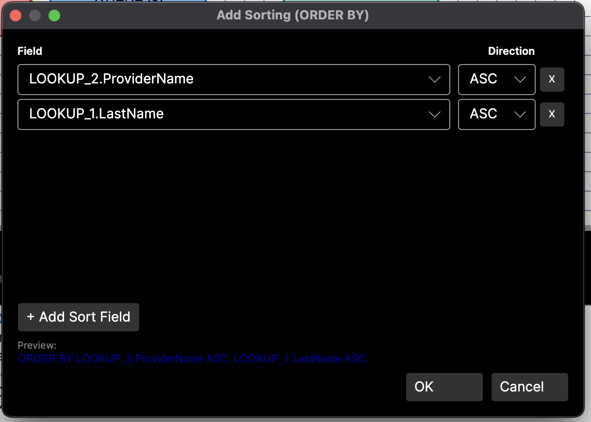
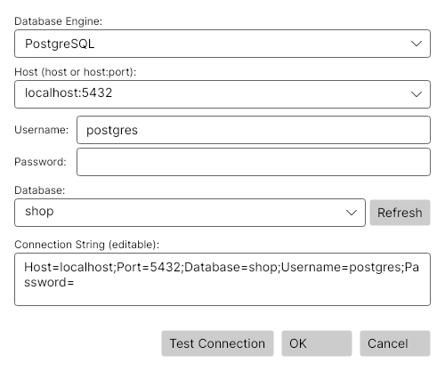

# AVA Query Builder

A visual SQL query builder built with .NET 10 and [Avalonia UI](https://avaloniaui.net/). Construct SELECT queries by visually configuring entities on a structured diagram canvas, then execute them against Microsoft SQL Server, PostgreSQL or SQLite and view results in an integrated data grid.

It also has an **AI Chat** (F12) and an **MCP server**: ask for "the top 5 providers by charges" or "patients with no visit this year" and watch Claude, or a model running on your own computer, find the tables, build the query on the diagram, have the database check it and count the rows. The agent reads the database's structure, never its rows, unless you allow it. See [AI: the chat and agents](#ai-the-chat-and-agents).

## Download

Builds for Windows, macOS and Linux (Intel/AMD and ARM) are on the
[latest release](https://github.com/Harlock123/AVAQueryBuilder/releases/tag/latest). Unzip or untar and run
`AVAQueryBuilder` (`AVAQueryBuilder.exe` on Windows); nothing else needs installing.

## Overview

AVA Query Builder provides a graphical approach to building SQL queries. Instead of writing SQL by hand, users add visual entities to a canvas — tables, lookup joins, derived fields, group by aggregates, limiters, distinct, filters, and sorting — and the application generates the corresponding SQL in real time. The generated query is displayed with syntax highlighting and can be executed directly against the connected database.

## Features

### Database Connection
- **Three engines** — Microsoft SQL Server, PostgreSQL and SQLite. Pick one at the top of the Connect dialog; the dialog shows the fields that engine needs, and the generated SQL follows its dialect (see [SQL dialects](#sql-dialects)).
- **Server Discovery** (SQL Server) — Browse for SQL Server instances on the local network via UDP broadcast to the SQL Browser service (port 1434).
- **Authentication** — Windows Authentication or SQL Server Authentication for SQL Server; a username and password for PostgreSQL. SQLite needs none: choose the database file.
- **Database Selection** — Queries the server for available databases and populates a dropdown for selection (SQL Server and PostgreSQL).
- **Connection String** — Auto-built from selections, or manually editable for environments with non-standard configurations.
- **Test Connection** — Verify connectivity before committing.

### Visual Query Building

Entities are added to an interactive canvas ([AVASdCanvas](https://github.com/harlock123/AVASdCanvas)) and connected with color-coded arrows to show relationships. Each entity type has a distinct color:

| Entity Type | Color | Description |
|---|---|---|
| **Table Source** | Light Green | A base table or view to SELECT from. Choose specific columns with optional aliases. |
| **Connected Source (Lookup)** | Light Purple | A join to another table. Supports LEFT JOIN, INNER JOIN, RIGHT JOIN, and FULL OUTER JOIN via a dropdown selector. Specify join keys and return fields with optional aliases. Aliased as `LOOKUP_1`, `LOOKUP_2`, etc. Includes a blue **?** help button with a color-coded reference explaining each join type. |
| **Derived Field** | Light Mint | Computed columns with 25+ derivations. **String:** UPPER, LOWER, TRIM, LEN, LEFT N, RIGHT N, REVERSE. **Date:** DATEPART (Year/Month/Day/Hour), DATENAME (Month/Day), Date Only, DATEDIFF (Days/Months/Years), DATEADD (Days/Months/Years). **Null handling:** ISNULL (Default), COALESCE (Fallback). **Numeric:** ABS, ROUND, CEILING, FLOOR. Each derived field requires an alias. |
| **Group By** | Rose Pink | GROUP BY with aggregate functions (COUNT, COUNT(*), COUNT DISTINCT, SUM, AVG, MIN, MAX). Includes optional HAVING clause with AND/OR conditions. Supports grouping by derived field expressions. When active, replaces the normal column list with grouped fields and aggregates. |
| **Limiter** | Light Red | Limits the query to its first N rows: `TOP N` on SQL Server, `LIMIT N` on PostgreSQL and SQLite. Toggle button — click to add, click again to remove. |
| **Distinct** | Light Orange | Adds `SELECT DISTINCT` to eliminate duplicate rows. Toggle button — no dialog needed. |
| **Filter** | Light Blue | Adds a `WHERE` clause with multiple conditions combined by AND/OR. Supports CAST AS (VARCHAR, INT, DATE, DATETIME, DECIMAL), BETWEEN, IN, NOT IN, LIKE, IS NULL, IS NOT NULL, IS EMPTY, IS NOT EMPTY. |
| **Sorting** | Light Yellow | Adds an `ORDER BY` clause with multiple fields, each ASC or DESC. Can sort by derived field expressions and aggregate functions. |

### Entity Interaction
- **Column Aliases** — Both table source and lookup return fields support optional aliases, generating `column AS [Alias]` in the SQL (`column AS "Alias"` on PostgreSQL and SQLite).
- **Double-click** any entity to edit its configuration. Changes are reflected immediately in the generated SQL.
- **Right-click** any entity for a context menu with Edit and Delete options. Deleting the base table removes all entities from the canvas.
- **Hover** over any entity to see a styled tooltip with its metadata summary (pale yellow background, Consolas font).
- **Toggle buttons** — Limiter and Distinct buttons toggle between Add/Remove states based on canvas state.

### Field Browser
Dialogs with table/view selection (Add Table Source, Add Connected Source) include a **Field Browser** button that opens a large resizable dialog displaying the table's first 100 rows in a LAWGrid, allowing users to browse table data before selecting columns or join keys.

### SQL Generation

The query builder scans all canvas entities and generates a SQL SELECT statement:

```sql
SELECT DISTINCT TOP 1000 dbo.Auths.AuthNumber AS [AUTHNUM],
       dbo.Auths.MemberID AS [MID],
       LOOKUP_1.LastName AS [LN], LOOKUP_1.SSN AS [SSN],
       DATEPART(YEAR, dbo.Auths.StartDate) AS [YEARauthed],
       DATEPART(MONTH, dbo.Auths.StartDate) AS [MONTHauthed]
FROM dbo.Auths
LEFT JOIN dbo.MemberMain AS LOOKUP_1 ON dbo.Auths.MemberID = LOOKUP_1.ID
LEFT JOIN dbo.Provider AS LOOKUP_2 ON dbo.Auths.ProviderID = LOOKUP_2.ID
WHERE dbo.Auths.ProviderID != '0'
      AND CAST(LOOKUP_1.SSN AS VARCHAR(MAX)) != ''
      AND dbo.Auths.StartDate BETWEEN '2023-01-01' AND '2023-12-31'
ORDER BY LOOKUP_2.ProviderName ASC, LOOKUP_1.LastName ASC
```

With GROUP BY:

```sql
SELECT dbo.Orders.Status,
       DATEPART(YEAR, dbo.Orders.OrderDate) AS [OrderYear],
       COUNT(*) AS [OrderCount],
       SUM(dbo.Orders.Amount) AS [TotalAmount]
FROM dbo.Orders
WHERE dbo.Orders.Status != 'Cancelled'
GROUP BY dbo.Orders.Status,
         DATEPART(YEAR, dbo.Orders.OrderDate)
HAVING COUNT(*) > 5
ORDER BY COUNT(*) DESC
```

The generated SQL updates live as entities are added, edited, or removed. Long lines are automatically wrapped at ~80 characters on natural boundaries.

### SQL Dialects

The examples above are SQL Server's. Connected to PostgreSQL or SQLite, the same canvas writes that engine's SQL:

| | SQL Server | PostgreSQL | SQLite |
|---|---|---|---|
| Row limit | `SELECT TOP 100 …` | `… LIMIT 100` | `… LIMIT 100` |
| Alias | `AS [Name]` | `AS "Name"` | `AS "Name"` |
| Length | `LEN(x)` | `LENGTH(CAST(x AS TEXT))` | `LENGTH(x)` |
| Year Part | `DATEPART(YEAR, x)` | `EXTRACT(YEAR FROM x)` | `STRFTIME('%Y', x)` |
| Month Name | `DATENAME(MONTH, x)` | `TO_CHAR(x, 'FMMonth')` | a `CASE` on the month |
| DATEDIFF (Days) | `DATEDIFF(DAY, x, p)` | `CAST(p AS DATE) - CAST(x AS DATE)` | `JULIANDAY(DATE(p)) - JULIANDAY(DATE(x))` |
| DATEADD (Months) | `DATEADD(MONTH, p, x)` | `x + p * INTERVAL '1 month'` | `DATETIME(x, p \|\| ' months')` |
| ISNULL (Default) | `ISNULL(x, 'p')` | `COALESCE(x, 'p')` | `IFNULL(x, 'p')` |
| Cast as VARCHAR | `VARCHAR(MAX)` | `VARCHAR` | `TEXT` |

DATEDIFF counts calendar boundaries crossed on every engine, as SQL Server does, so March 31 to April 1 is one month.
A derivation's parameter is SQL in the connected engine's own syntax: a date is `GETDATE()` on SQL Server,
`NOW()` or `CURRENT_DATE` on PostgreSQL, and `DATE('now')` on SQLite. SQLite has no `REVERSE`, so that
derivation isn't offered there. Table and column names are written as the database reports them, unquoted;
PostgreSQL folds unquoted names to lower case, so tables created with quoted mixed-case names won't resolve.

### Query Execution

- **Execute Query** button runs the generated SQL against the connected database.
- Results are displayed in an integrated data grid ([LAWgrid](https://github.com/harlock123/LAWgrid)) with the Results Grid tab automatically selected.
- **Status bar** displays row count and execution time after each query (e.g., "Returned 1,247 row(s) in 0.3s").
- **Copy SQL** button copies the generated query text to the clipboard.
- **Export to Excel** button exports the current results grid to an Excel file (`.xlsx`) with full formatting via a save file dialog.
- **Clear Canvas** button resets all entities, connectors, query text, and results grid in one click.
- **Undo and Redo** (Ctrl+Z, Ctrl+Y, the Undo and Redo buttons, or the Edit menu) step through every change to the query: entities added, edited or deleted, Clear Canvas, and an AI agent's steps.

### Syntax Highlighting

The generated SQL is displayed using the [SyntaxColorizer](https://github.com/Harlock123/SyntaxColorizer) control with MS SQL language support, line numbers, and the GitHub Light theme.

### Save / Load

- **Save Query** (`.qry`) — Persists the entire query state to a JSON file: connection string, all canvas entities with positions and metadata, all connectors, and the lookup ordinal counter.
- **Load Query** — Restores a previously saved query, rehydrating the canvas, connection string, and all entity configurations. Toggle button states (Limiter, Distinct) update automatically.
- The **File** menu has New Query (Ctrl+N), Load Query (Ctrl+O), Save Query (Ctrl+S, to the file it came from) and Save Query As. The title bar shows the file and a `*` while there are unsaved changes.
- Values in filters and CASE expressions are written as SQL string literals with any `'` doubled, so `O'Brien` matches O'Brien and no value can end the literal early.

## AI: the chat and agents



**The AI Chat** (F12, or AI › AI Chat) docks on the right. Describe the query you want; the model reads the
database's structure, builds the query with the same entities you use, checks it with the database, runs it and
says what it returns. Each step shows in the panel as it happens and is one undo step (Ctrl+Z takes it back), and
**Undo this reply** takes back a whole answer. The **Timeline** lists each reply that changed the query, with the
diagram as it was before it. **History** keeps past chats if you tick Keep chat history.

Setup… chooses the model, through either of two APIs:

- **Anthropic API**: Claude (Opus, Sonnet or Haiku), with your Anthropic API key (Key…, or the
  `ANTHROPIC_API_KEY` environment variable). Or give **Server** the address of a model server on this computer or
  your network that speaks the same API, such as **LM Studio** (`http://localhost:1234`) or **Ollama**
  (`http://localhost:11434`), and the model's name there (Refresh lists them). A local server needs no key.
- **OpenAI-compatible**: LM Studio (`http://localhost:1234/v1`), Ollama (`http://localhost:11434/v1`), vLLM,
  llama.cpp, a server elsewhere on your network, OpenAI or another cloud service, or a company gateway.



For a small local model, tick **Core tools only** (16 tools in place of 42; small models choose better among
fewer), and leave **Model sees pictures** off unless it's a vision model. A model running on your own computer
sends nothing anywhere and costs nothing; Claude's use is counted as it goes, with an estimated cost per chat,
daily and monthly totals, and an optional budget (Setup…).

**Protected data.** Query results are often patients', members' or staff records, so AI agents don't see them
unless you turn on **AI › Let AI Agents See Query Results**. Until then an agent gets the database's catalogue
(tables, columns, types, keys and foreign keys), a query's row count and its columns, and the rows go to your
Results Grid only. Nothing an agent does writes to a database: queries are SELECTs, run inside a transaction that is
rolled back (read-only on PostgreSQL and SQLite). Saved connections (AI › Database Connections) are shown to agents
by name, engine and server, never with their passwords.

**Agents outside the program.** Claude Code, Claude Desktop or any MCP client can work in the open window: turn on
AI › Allow AI Agents (MCP), then add the server, for Claude Code:

```bash
claude mcp add avaquerybuilder -- /path/to/AVAQueryBuilder --mcp --attach
```

Without `--attach`, `AVAQueryBuilder --mcp` is a server with a query of its own and no window (add `--rows` to let
its agents see rows). AI › Connect an Agent also opens a network door (MCP over HTTP, port 8771, with an access
token) for agents on other computers. `AVAQueryBuilder --mcp --help` lists the options.

**The tools** (42): reading the query and its SQL (for any engine, to port it); connections; the catalogue
(`list_tables`, `describe_table` with the joins its foreign keys suggest, `find_columns`); building (`build_query`
for a whole query in one call, then `add_table`, `add_lookup`, `add_filter`, `set_derived`, `set_case_when`,
`set_group_by`, `set_sort`, `set_limit`, `set_distinct`, `remove` and their edits); `check_query` (the database
checks the SQL), `run_query`, `export_results` (.csv or .xlsx) and `render_view` (a picture of the diagram); files
in the working folder (AI › Working Folder); undo and redo; and for longer work `batch` (several changes as one
undo step, or a dry run), checkpoints with `diff`, and steps files (`save_steps`, `run_steps`) that rerun a
sequence with new values, such as a monthly report for another month.

**Recipes** (MCP prompts): a question in plain words as a query, counts by month, records with no related record,
possible duplicates, top N by a total, a date-range report kept to rerun, explaining a saved query, and moving a
query to another engine.

**Try it** on `samples/clinic.db`, a small made-up clinic (providers, patients and visits; every name and figure is
invented): Connect to Data › SQLite, or AI › Database Connections.

## Screenshots

### Main Application — Canvas with Entities and Results Grid


### Main Application — Generated SQL with Syntax Highlighting


### Add Filter Dialog (WHERE Clause) — with CAST and BETWEEN support


### Add Connected Source Dialog (Lookup Join) — with Column Aliases


### Join Types Reference — accessed via the blue ? button


### Add Derived Field Dialog — DATEPART Derivations


### Add Sorting Dialog (ORDER BY)


### Connect Dialog — choosing PostgreSQL


## UI Layout

A menu bar (File, Edit, AI) runs along the top, and the AI Chat docks on the right when it's open (F12).

```
+------------------+--------------------------------------------+
|                  |  Connection String                         |
|  [Connect]       +--------------------------------------------+
|  [Add Table]     |                                            |
|  [Add Lookup]    |  Canvas (AVASdCanvas)                      |
|  [Add Derived]   |  +--------+     +-----------+              |
|  [Add Group By]  |  | Table  |<----| Lookup    |              |
|  [Add Limiter]   |  +--------+     +-----------+              |
|  [Add Distinct]  |    |  |  |      +-----------+              |
|  [Add Filter]    |    |  |  +----->| TOP 100   |              |
|  [Add Sorting]   |    |  +------->| WHERE (3) |               |
|                  |    +---------->| ORDER BY  |               |
|                  |    |           +-----------+               |
|                  |    +---------->| GROUP BY  |               |
|                  |  +----------+                              |
|                  |  | DISTINCT |                              |
|  ----------      |                                            |
|  [Undo] [Redo]   |                                            |
|  [Clear Canvas]  +==========[ Copy SQL ][ Execute ][ Export ]=+
|  [Save Query]    |  [Derived Query] [Results Grid]            |
|  [Load Query]    |  SELECT TOP 100 col1 AS [Name], ...        |
|                  |  FROM dbo.Table INNER JOIN ...             |
|                  +--------------------------------------------+
|                  |  Returned 1,247 row(s) in 0.3s             |
+------------------+--------------------------------------------+
```

## Technology Stack

- **.NET 10** — Target framework
- **Avalonia UI 11.3** — Cross-platform UI framework
- **Microsoft.Data.SqlClient**, **Npgsql** and **Microsoft.Data.Sqlite** — SQL Server, PostgreSQL and SQLite connectivity
- **[LAWgrid](https://www.nuget.org/packages/LAWgrid)** — Data grid control by Lonnie Watson
- **[SyntaxColorizer](https://www.nuget.org/packages/SyntaxColorizer)** — Syntax highlighting text editor by Lonnie Watson
- **[AVASdCanvas](https://www.nuget.org/packages/AVASdCanvas)** — Structured diagram canvas by Lonnie Watson
- **[ModelContextProtocol](https://www.nuget.org/packages/ModelContextProtocol.Core)** — the official C# MCP SDK, for the MCP server and its network door
- **[Anthropic](https://www.nuget.org/packages/Anthropic)** — the official C# SDK, for the AI Chat's Anthropic API (Claude, or a local server that speaks it)

## Building

```bash
dotnet build
```

## Running

```bash
dotnet run --project AVAQueryBuilder
```

## Testing

```bash
dotnet test
```

The tests build queries the way the dialogs do and run them on each engine: every derivation, joins, filters,
grouping, sorting and limits. SQLite runs in a temporary file. SQL Server and PostgreSQL use the servers in
`AQB_TEST_SQLSERVER` and `AQB_TEST_POSTGRES` (connection strings), falling back to the sample servers from
[CCReimagined](https://github.com/Harlock123/CCReimagined)'s `dev/sample-databases` on localhost; when neither
answers, those tests are skipped. Each run makes its own tables and drops them afterwards.

The agent tests drive the MCP server through a real MCP client, on a copy of `samples/clinic.db`: every tool, every
recipe call by call, the open window (Ctrl+Z undoing an agent's step), the pipe and network doors, and the chat on
scripted fakes of both model APIs. No real model, key or server is used. Two kinds of test are opt-in:

```bash
AQB_LIVE_SERVER=http://localhost:11434 AQB_LIVE_MODEL=qwen3:1.7b dotnet test --filter LiveModelTests
AQB_SHOTS=/tmp/shots dotnet test --filter "Pictures|AiChatScreenshot"
```

The first runs the chat on a real model through both APIs (Ollama speaks both; the model must call tools). The
second writes the README's pictures.

## Project Structure

```
AVAQueryBuilder/
├── MainWindow.axaml/.cs                  — Main window, canvas events, save/load
├── App.axaml/.cs                         — Application entry point
├── Program.cs                            — Host builder
├── AppState.cs                           — Global state (engine and connection string)
├── Database.cs                           — Connections, schema lists and query runs for each engine
├── Dialect.cs                            — What differs between the engines' SQL
├── QueryBuilder.cs                       — SQL generation with line wrapping
├── QueryFile.cs                          — Serialization model for .qry files
├── QueryModel.cs                         — QueryEdits (every change to a query) and QueryHistory (undo/redo)
├── QueryLook.cs                          — How a query is drawn on the canvas
├── Agents/                               — The AI Chat (Chat/, ChatPanel.cs) and the MCP server (Mcp/)
├── ConnectionStringDialog.axaml/.cs      — Database connection dialog
├── AddTableSourceDialog.axaml/.cs        — Table/view and column selection
├── AddConnectedSourceDialog.axaml/.cs    — Lookup join configuration
├── AddDerivedDialog.axaml/.cs            — Derived field dialog
├── AddGroupByDialog.axaml/.cs            — GROUP BY and aggregate dialog
├── AddLimiterDialog.axaml/.cs            — TOP N limiter dialog
├── AddFilterDialog.axaml/.cs             — WHERE clause builder
├── AddSortingDialog.axaml/.cs            — ORDER BY builder
├── FieldBrowserDialog.axaml/.cs          — Table data browser (first 100 rows)
├── JoinTypesHelpWindow.axaml/.cs         — Join type reference dialog
├── UnderConstructionWindow.axaml/.cs     — Placeholder dialog
├── TableSourceResult.cs                  — Table entity metadata
├── ConnectedSourceResult.cs              — Lookup entity metadata
├── DerivedFieldResult.cs                 — Derived field metadata
├── DerivedFieldViewModel.cs              — Derived field row view model
├── GroupByResult.cs                      — Group By entity metadata
├── AggregateViewModel.cs                 — Aggregate/HAVING row view models
├── LimiterResult.cs                      — Limiter entity metadata
├── DistinctResult.cs                     — Distinct entity metadata
├── FilterResult.cs                       — Filter entity metadata
├── FilterConditionViewModel.cs           — Filter condition row view model
├── SortingResult.cs                      — Sorting entity metadata
├── SortingFieldViewModel.cs              — Sorting row view model
├── ColumnItem.cs                         — Bindable column model with alias
└── AVAQueryBuilder.csproj                — Project file
tests/AVAQueryBuilder.Tests/              — Query tests on each engine, the Connect dialog headless, and the agent tests (Agents/)
samples/                                  — clinic.sql and clinic.db, a made-up clinic to try queries on
Screenshots/                              — Application screenshots
```

## License

MIT. See [LICENSE](LICENSE).
