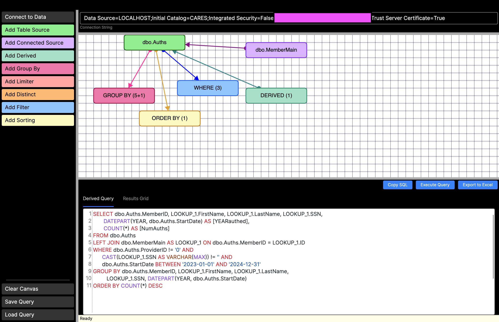
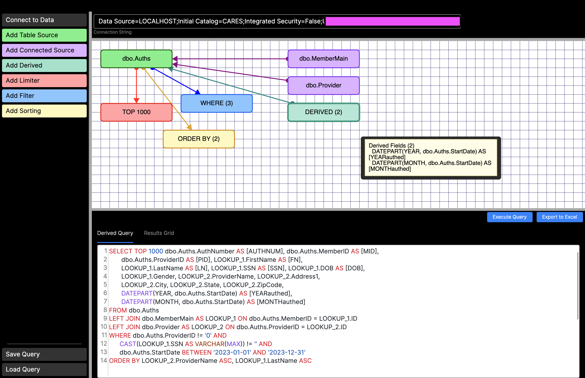
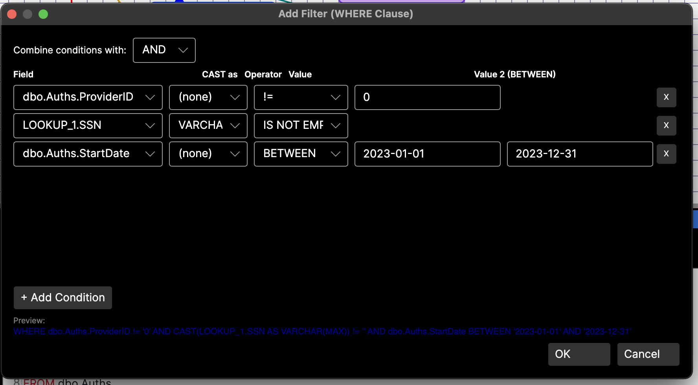
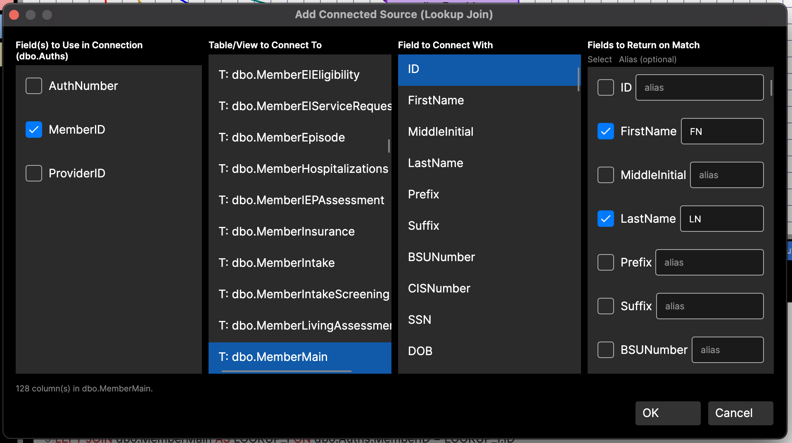
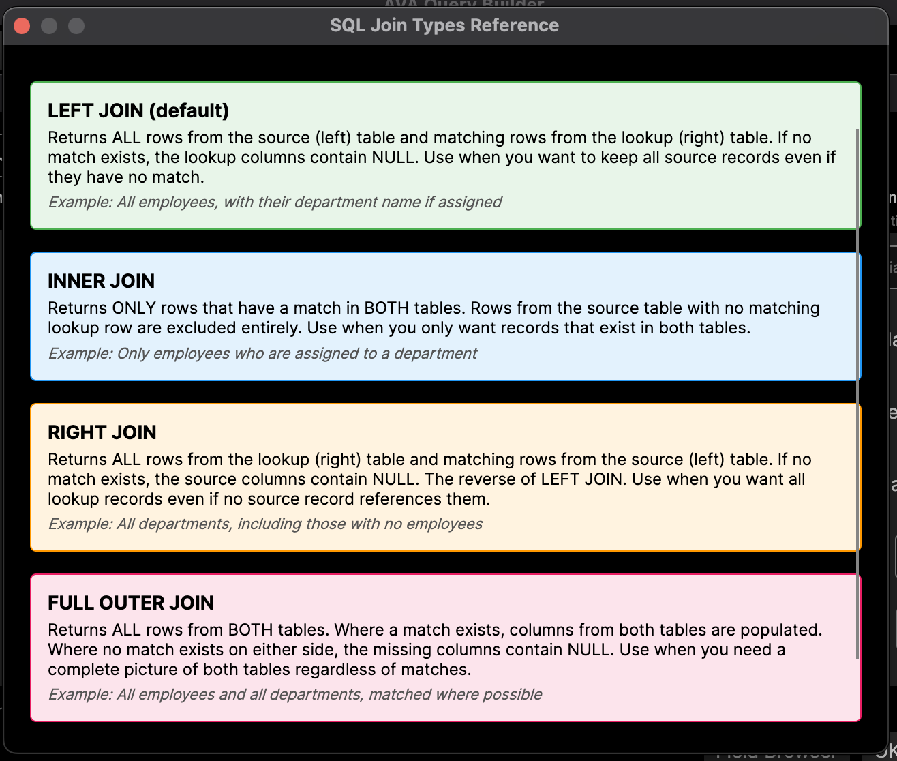
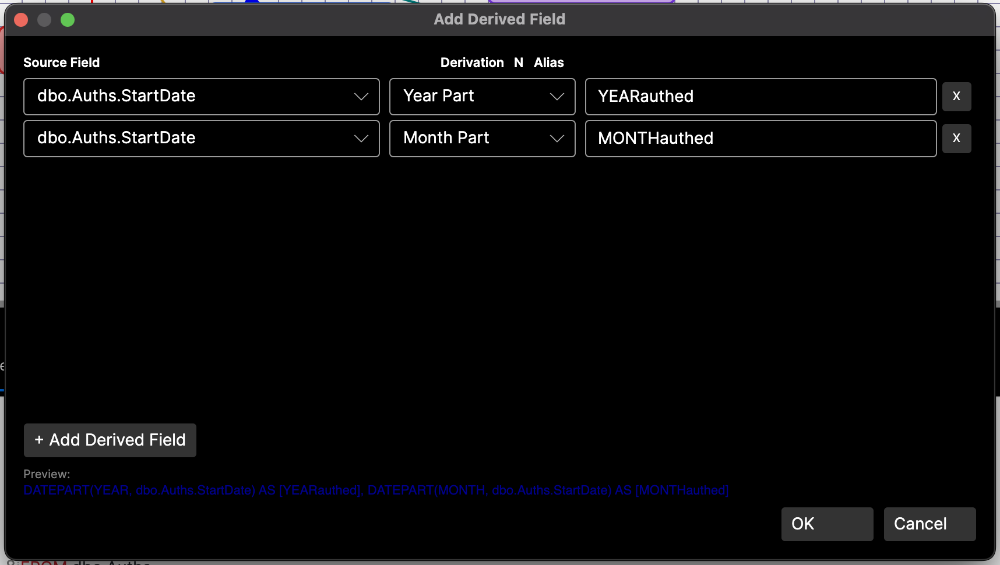
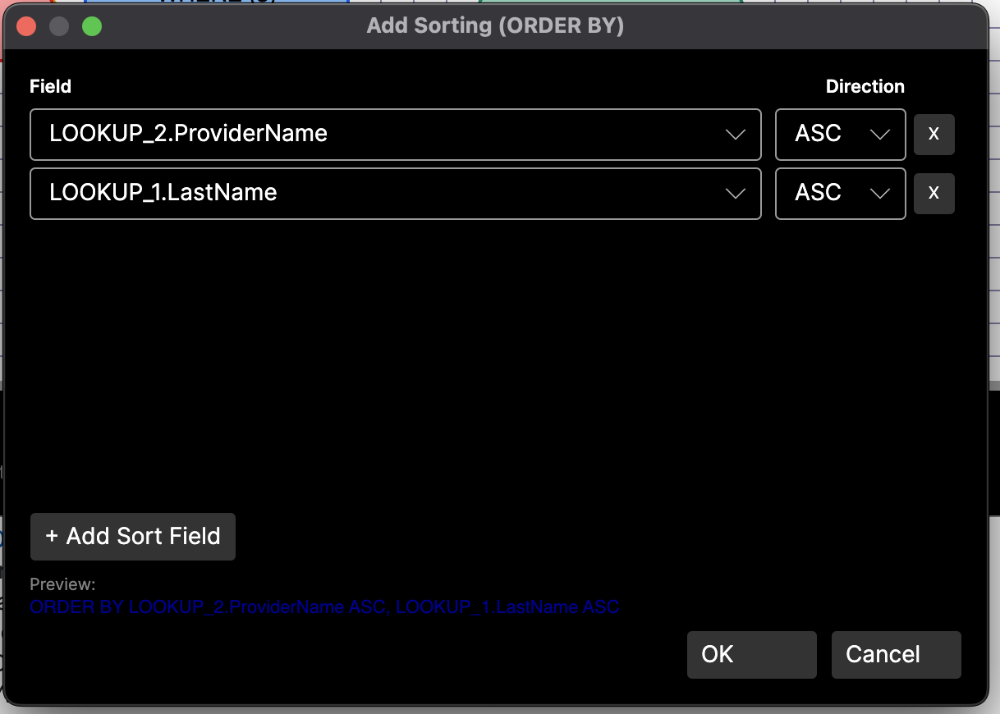
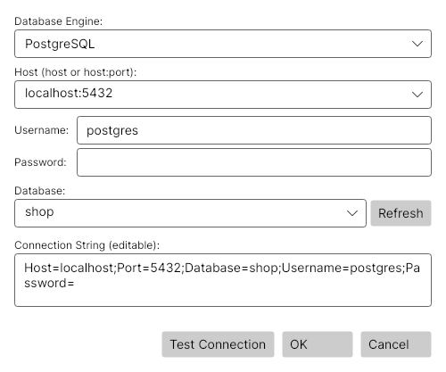

# AVA Query Builder

A visual SQL query builder built with .NET 10 and [Avalonia UI](https://avaloniaui.net/). Construct SELECT queries by visually configuring entities on a structured diagram canvas, then execute them against Microsoft SQL Server, PostgreSQL or SQLite and view results in an integrated data grid.

## Download

Builds for Windows, macOS and Linux (Intel/AMD and ARM) are on the
[latest release](https://github.com/Harlock123/AVAQueryBuilder/releases/tag/latest). Unzip or untar and run
`AVAQueryBuilder` (`AVAQueryBuilder.exe` on Windows); nothing else needs installing.

## Overview

AVA Query Builder provides a graphical approach to building SQL queries. Instead of writing SQL by hand, users add visual entities to a canvas — tables, lookup joins, derived fields, group by aggregates, limiters, distinct, filters, and sorting — and the application generates the corresponding SQL in real time. The generated query is displayed with syntax highlighting and can be executed directly against the connected database.

## Features

### Database Connection
- **Three engines** — Microsoft SQL Server, PostgreSQL and SQLite. Pick one at the top of the Connect dialog; the dialog shows the fields that engine needs, and the generated SQL follows its dialect (see [SQL dialects](#sql-dialects)).
- **Server Discovery** (SQL Server) — Browse for SQL Server instances on the local network via UDP broadcast to the SQL Browser service (port 1434).
- **Authentication** — Windows Authentication or SQL Server Authentication for SQL Server; a username and password for PostgreSQL. SQLite needs none: choose the database file.
- **Database Selection** — Queries the server for available databases and populates a dropdown for selection (SQL Server and PostgreSQL).
- **Connection String** — Auto-built from selections, or manually editable for environments with non-standard configurations.
- **Test Connection** — Verify connectivity before committing.

### Visual Query Building

Entities are added to an interactive canvas ([AVASdCanvas](https://github.com/harlock123/AVASdCanvas)) and connected with color-coded arrows to show relationships. Each entity type has a distinct color:

| Entity Type | Color | Description |
|---|---|---|
| **Table Source** | Light Green | A base table or view to SELECT from. Choose specific columns with optional aliases. |
| **Connected Source (Lookup)** | Light Purple | A join to another table. Supports LEFT JOIN, INNER JOIN, RIGHT JOIN, and FULL OUTER JOIN via a dropdown selector. Specify join keys and return fields with optional aliases. Aliased as `LOOKUP_1`, `LOOKUP_2`, etc. Includes a blue **?** help button with a color-coded reference explaining each join type. |
| **Derived Field** | Light Mint | Computed columns with 25+ derivations. **String:** UPPER, LOWER, TRIM, LEN, LEFT N, RIGHT N, REVERSE. **Date:** DATEPART (Year/Month/Day/Hour), DATENAME (Month/Day), Date Only, DATEDIFF (Days/Months/Years), DATEADD (Days/Months/Years). **Null handling:** ISNULL (Default), COALESCE (Fallback). **Numeric:** ABS, ROUND, CEILING, FLOOR. Each derived field requires an alias. |
| **Group By** | Rose Pink | GROUP BY with aggregate functions (COUNT, COUNT(*), COUNT DISTINCT, SUM, AVG, MIN, MAX). Includes optional HAVING clause with AND/OR conditions. Supports grouping by derived field expressions. When active, replaces the normal column list with grouped fields and aggregates. |
| **Limiter** | Light Red | Limits the query to its first N rows: `TOP N` on SQL Server, `LIMIT N` on PostgreSQL and SQLite. Toggle button — click to add, click again to remove. |
| **Distinct** | Light Orange | Adds `SELECT DISTINCT` to eliminate duplicate rows. Toggle button — no dialog needed. |
| **Filter** | Light Blue | Adds a `WHERE` clause with multiple conditions combined by AND/OR. Supports CAST AS (VARCHAR, INT, DATE, DATETIME, DECIMAL), BETWEEN, IN, NOT IN, LIKE, IS NULL, IS NOT NULL, IS EMPTY, IS NOT EMPTY. |
| **Sorting** | Light Yellow | Adds an `ORDER BY` clause with multiple fields, each ASC or DESC. Can sort by derived field expressions and aggregate functions. |

### Entity Interaction
- **Column Aliases** — Both table source and lookup return fields support optional aliases, generating `column AS [Alias]` in the SQL (`column AS "Alias"` on PostgreSQL and SQLite).
- **Double-click** any entity to edit its configuration. Changes are reflected immediately in the generated SQL.
- **Right-click** any entity for a context menu with Edit and Delete options. Deleting the base table removes all entities from the canvas.
- **Hover** over any entity to see a styled tooltip with its metadata summary (pale yellow background, Consolas font).
- **Toggle buttons** — Limiter and Distinct buttons toggle between Add/Remove states based on canvas state.

### Field Browser
Dialogs with table/view selection (Add Table Source, Add Connected Source) include a **Field Browser** button that opens a large resizable dialog displaying the table's first 100 rows in a LAWGrid, allowing users to browse table data before selecting columns or join keys.

### SQL Generation

The query builder scans all canvas entities and generates a SQL SELECT statement:

```sql
SELECT DISTINCT TOP 1000 dbo.Auths.AuthNumber AS [AUTHNUM],
       dbo.Auths.MemberID AS [MID],
       LOOKUP_1.LastName AS [LN], LOOKUP_1.SSN AS [SSN],
       DATEPART(YEAR, dbo.Auths.StartDate) AS [YEARauthed],
       DATEPART(MONTH, dbo.Auths.StartDate) AS [MONTHauthed]
FROM dbo.Auths
LEFT JOIN dbo.MemberMain AS LOOKUP_1 ON dbo.Auths.MemberID = LOOKUP_1.ID
LEFT JOIN dbo.Provider AS LOOKUP_2 ON dbo.Auths.ProviderID = LOOKUP_2.ID
WHERE dbo.Auths.ProviderID != '0'
      AND CAST(LOOKUP_1.SSN AS VARCHAR(MAX)) != ''
      AND dbo.Auths.StartDate BETWEEN '2023-01-01' AND '2023-12-31'
ORDER BY LOOKUP_2.ProviderName ASC, LOOKUP_1.LastName ASC
```

With GROUP BY:

```sql
SELECT dbo.Orders.Status,
       DATEPART(YEAR, dbo.Orders.OrderDate) AS [OrderYear],
       COUNT(*) AS [OrderCount],
       SUM(dbo.Orders.Amount) AS [TotalAmount]
FROM dbo.Orders
WHERE dbo.Orders.Status != 'Cancelled'
GROUP BY dbo.Orders.Status,
         DATEPART(YEAR, dbo.Orders.OrderDate)
HAVING COUNT(*) > 5
ORDER BY COUNT(*) DESC
```

The generated SQL updates live as entities are added, edited, or removed. Long lines are automatically wrapped at ~80 characters on natural boundaries.

### SQL Dialects

The examples above are SQL Server's. Connected to PostgreSQL or SQLite, the same canvas writes that engine's SQL:

| | SQL Server | PostgreSQL | SQLite |
|---|---|---|---|
| Row limit | `SELECT TOP 100 …` | `… LIMIT 100` | `… LIMIT 100` |
| Alias | `AS [Name]` | `AS "Name"` | `AS "Name"` |
| Length | `LEN(x)` | `LENGTH(CAST(x AS TEXT))` | `LENGTH(x)` |
| Year Part | `DATEPART(YEAR, x)` | `EXTRACT(YEAR FROM x)` | `STRFTIME('%Y', x)` |
| Month Name | `DATENAME(MONTH, x)` | `TO_CHAR(x, 'FMMonth')` | a `CASE` on the month |
| DATEDIFF (Days) | `DATEDIFF(DAY, x, p)` | `CAST(p AS DATE) - CAST(x AS DATE)` | `JULIANDAY(DATE(p)) - JULIANDAY(DATE(x))` |
| DATEADD (Months) | `DATEADD(MONTH, p, x)` | `x + p * INTERVAL '1 month'` | `DATETIME(x, p \|\| ' months')` |
| ISNULL (Default) | `ISNULL(x, 'p')` | `COALESCE(x, 'p')` | `IFNULL(x, 'p')` |
| Cast as VARCHAR | `VARCHAR(MAX)` | `VARCHAR` | `TEXT` |

DATEDIFF counts calendar boundaries crossed on every engine, as SQL Server does, so March 31 to April 1 is one month.
A derivation's parameter is SQL in the connected engine's own syntax: a date is `GETDATE()` on SQL Server,
`NOW()` or `CURRENT_DATE` on PostgreSQL, and `DATE('now')` on SQLite. SQLite has no `REVERSE`, so that
derivation isn't offered there. Table and column names are written as the database reports them, unquoted;
PostgreSQL folds unquoted names to lower case, so tables created with quoted mixed-case names won't resolve.

### Query Execution

- **Execute Query** button runs the generated SQL against the connected database.
- Results are displayed in an integrated data grid ([LAWgrid](https://github.com/harlock123/LAWgrid)) with the Results Grid tab automatically selected.
- **Status bar** displays row count and execution time after each query (e.g., "Returned 1,247 row(s) in 0.3s").
- **Copy SQL** button copies the generated query text to the clipboard.
- **Export to Excel** button exports the current results grid to an Excel file (`.xlsx`) with full formatting via a save file dialog.
- **Clear Canvas** button resets all entities, connectors, query text, and results grid in one click.

### Syntax Highlighting

The generated SQL is displayed using the [SyntaxColorizer](https://github.com/Harlock123/SyntaxColorizer) control with MS SQL language support, line numbers, and the GitHub Light theme.

### Save / Load

- **Save Query** (`.qry`) — Persists the entire query state to a JSON file: connection string, all canvas entities with positions and metadata, all connectors, and the lookup ordinal counter.
- **Load Query** — Restores a previously saved query, rehydrating the canvas, connection string, and all entity configurations. Toggle button states (Limiter, Distinct) update automatically.

## Screenshots

### Main Application — Canvas with Entities and Results Grid


### Main Application — Generated SQL with Syntax Highlighting


### Add Filter Dialog (WHERE Clause) — with CAST and BETWEEN support


### Add Connected Source Dialog (Lookup Join) — with Column Aliases


### Join Types Reference — accessed via the blue ? button


### Add Derived Field Dialog — DATEPART Derivations


### Add Sorting Dialog (ORDER BY)


### Connect Dialog — choosing PostgreSQL


## UI Layout

```
+------------------+--------------------------------------------+
|                  |  Connection String                         |
|  [Connect]       +--------------------------------------------+
|  [Add Table]     |                                            |
|  [Add Lookup]    |  Canvas (AVASdCanvas)                      |
|  [Add Derived]   |  +--------+     +-----------+              |
|  [Add Group By]  |  | Table  |<----| Lookup    |              |
|  [Add Limiter]   |  +--------+     +-----------+              |
|  [Add Distinct]  |    |  |  |      +-----------+              |
|  [Add Filter]    |    |  |  +----->| TOP 100   |              |
|  [Add Sorting]   |    |  +------->| WHERE (3) |               |
|                  |    +---------->| ORDER BY  |               |
|                  |    |           +-----------+               |
|                  |    +---------->| GROUP BY  |               |
|                  |  +----------+                              |
|                  |  | DISTINCT |                              |
|  ----------      |                                            |
|  [Clear Canvas]  +==========[ Copy SQL ][ Execute ][ Export ]=+
|  [Save Query]    |  [Derived Query] [Results Grid]            |
|  [Load Query]    |  SELECT TOP 100 col1 AS [Name], ...        |
|                  |  FROM dbo.Table INNER JOIN ...             |
|                  +--------------------------------------------+
|                  |  Returned 1,247 row(s) in 0.3s             |
+------------------+--------------------------------------------+
```

## Technology Stack

- **.NET 10** — Target framework
- **Avalonia UI 11.3** — Cross-platform UI framework
- **Microsoft.Data.SqlClient**, **Npgsql** and **Microsoft.Data.Sqlite** — SQL Server, PostgreSQL and SQLite connectivity
- **[LAWgrid](https://www.nuget.org/packages/LAWgrid)** — Data grid control by Lonnie Watson
- **[SyntaxColorizer](https://www.nuget.org/packages/SyntaxColorizer)** — Syntax highlighting text editor by Lonnie Watson
- **[AVASdCanvas](https://www.nuget.org/packages/AVASdCanvas)** — Structured diagram canvas by Lonnie Watson

## Building

```bash
dotnet build
```

## Running

```bash
dotnet run --project AVAQueryBuilder
```

## Testing

```bash
dotnet test
```

The tests build queries the way the dialogs do and run them on each engine: every derivation, joins, filters,
grouping, sorting and limits. SQLite runs in a temporary file. SQL Server and PostgreSQL use the servers in
`AQB_TEST_SQLSERVER` and `AQB_TEST_POSTGRES` (connection strings), falling back to the sample servers from
[CCReimagined](https://github.com/Harlock123/CCReimagined)'s `dev/sample-databases` on localhost; when neither
answers, those tests are skipped. Each run makes its own tables and drops them afterwards.

## Project Structure

```
AVAQueryBuilder/
├── MainWindow.axaml/.cs                  — Main window, canvas events, save/load
├── App.axaml/.cs                         — Application entry point
├── Program.cs                            — Host builder
├── AppState.cs                           — Global state (engine and connection string)
├── Database.cs                           — Connections, schema lists and query runs for each engine
├── Dialect.cs                            — What differs between the engines' SQL
├── QueryBuilder.cs                       — SQL generation with line wrapping
├── QueryFile.cs                          — Serialization model for .qry files
├── ConnectionStringDialog.axaml/.cs      — Database connection dialog
├── AddTableSourceDialog.axaml/.cs        — Table/view and column selection
├── AddConnectedSourceDialog.axaml/.cs    — Lookup join configuration
├── AddDerivedDialog.axaml/.cs            — Derived field dialog
├── AddGroupByDialog.axaml/.cs            — GROUP BY and aggregate dialog
├── AddLimiterDialog.axaml/.cs            — TOP N limiter dialog
├── AddFilterDialog.axaml/.cs             — WHERE clause builder
├── AddSortingDialog.axaml/.cs            — ORDER BY builder
├── FieldBrowserDialog.axaml/.cs          — Table data browser (first 100 rows)
├── JoinTypesHelpWindow.axaml/.cs         — Join type reference dialog
├── UnderConstructionWindow.axaml/.cs     — Placeholder dialog
├── TableSourceResult.cs                  — Table entity metadata
├── ConnectedSourceResult.cs              — Lookup entity metadata
├── DerivedFieldResult.cs                 — Derived field metadata
├── DerivedFieldViewModel.cs              — Derived field row view model
├── GroupByResult.cs                      — Group By entity metadata
├── AggregateViewModel.cs                 — Aggregate/HAVING row view models
├── LimiterResult.cs                      — Limiter entity metadata
├── DistinctResult.cs                     — Distinct entity metadata
├── FilterResult.cs                       — Filter entity metadata
├── FilterConditionViewModel.cs           — Filter condition row view model
├── SortingResult.cs                      — Sorting entity metadata
├── SortingFieldViewModel.cs              — Sorting row view model
├── ColumnItem.cs                         — Bindable column model with alias
└── AVAQueryBuilder.csproj                — Project file
tests/AVAQueryBuilder.Tests/              — Query tests on each engine, and the Connect dialog headless
Screenshots/                              — Application screenshots
```

## License

MIT. See [LICENSE](LICENSE).
